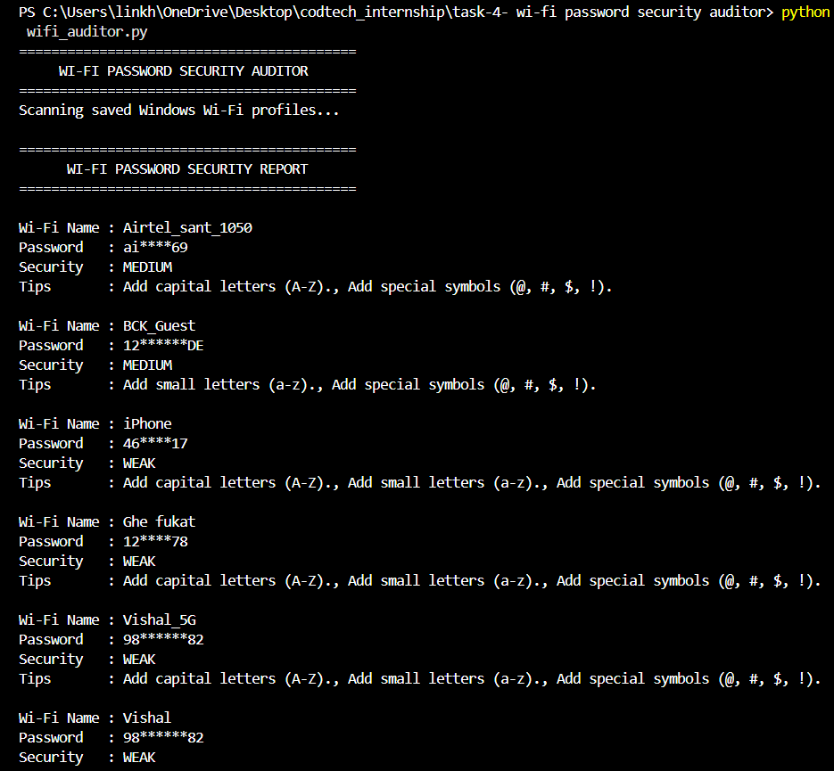

# Task 4: Wi-Fi Password Security Auditor

This is a Python tool made for the **CodTech IT Solutions Cybersecurity Internship**. It checks saved Wi-Fi networks on Windows and audits their password strength to help prevent unauthorized access.

## What It Does
* Reads saved Wi-Fi profiles on Windows using the built-in `netsh` command.
* Masks the password in the output so sensitive details stay private.
* Checks password length, uppercase/lowercase letters, numbers, and symbols.
* Flags passwords that contain the Wi-Fi network name and gives security tips.

## How to Run
1. Run this command in the terminal:
   python wifi_auditor.py
2. View the security report and improvement tips for each saved Wi-Fi network.

## Output Screenshot
